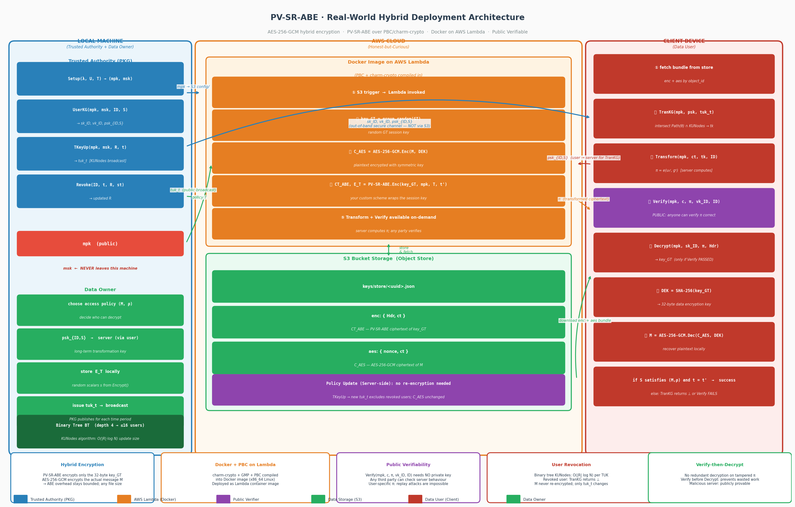

# PV-SR-ABE: Publicly Verifiable, Server-Aided Revocable Attribute-Based Encryption

**Research prototype | Cloud security | Fine-grained access control | AWS Lambda**

A proof-of-concept implementation of **Public Verifiable Server-Aided Revocable Attribute-Based Encryption (PV-SR-ABE)**, exploring how pairing-based access control, user revocation and publicly verifiable outsourced computation can be integrated with a containerised AWS Lambda environment.

> **Project status:** Research / demonstration prototype, **not production-ready**. The repository includes both a local cryptographic workflow and AWS Lambda service components. These paths should not be confused with a fully validated end-to-end production deployment.



## Overview

Conventional attribute-based encryption (ABE) enables access control over encrypted data using attribute policies. Outsourcing pairing-heavy operations to a server can reduce client-side work, but creates a new question: **how can a user or independent auditor check that the server performed its transformation correctly?**

This project investigates a **transform → publicly verify → decrypt** workflow alongside time-based revocation. To handle arbitrary-length data, it combines a pairing-based ABE scheme with **AES-256-GCM** hybrid encryption.

## Key features

- **Fine-grained access policies:** ciphertext access conditions expressed using user attributes.
- **Public verification:** a verification step designed to check outsourced transformations without requiring the verifier to hold the user's decryption secret.
- **Time-based user revocation:** revocation state and time-update keys are managed by a local trusted authority.
- **Hybrid encryption:** an ABE-protected pairing-group session key is used to derive a 256-bit AES-GCM data-encryption key.
- **Cloud integration:** a Docker image packages the native pairing dependencies for AWS Lambda; service code also supports S3 interactions.
- **Tests and documentation:** examples cover successful decryption, policy mismatch and time mismatch.

These are **design and implementation goals** of the prototype, not an independent security certification or a claim that every cloud path has been exhaustively tested.

## Architecture and trust boundaries

| Component | Responsibility |
| --- | --- |
| Trusted authority / PKG | Setup, user key issuance, revocation and time-update keys |
| Data owner / encryption workflow | Encrypt data under an attribute policy and time period |
| Server / AWS Lambda | Perform delegated operations and manage cloud-side workflow |
| Public verifier | Check a transformation against public verification material |
| Authorised client | Complete decryption and recover the AES-GCM plaintext |

**Key separation:** the master secret key belongs to the trusted authority and must not be included in a Lambda image, uploaded to S3 or committed to Git. The local proof of concept serialises sensitive setup and user material to JSON for testing; these outputs must be treated as secrets.

See [Algorithm Overview](docs/algorithm_overview.md), [Security Model](docs/security_model.md) and [Public Verification](docs/PUBLIC_VERIFICATION.md).

## Hybrid encryption workflow

1. Generate a random session key in the pairing target group, `GT`.
2. Derive a 32-byte data-encryption key from the serialised group element using SHA-256.
3. Encrypt the plaintext with AES-256-GCM.
4. Protect the session key using PV-SR-ABE under an attribute policy and time period.
5. Obtain the appropriate time-update material and perform the outsourced transformation.
6. Verify the transformation, recover the session key and authenticate/decrypt the AES-GCM ciphertext.

The original research scheme's security arguments do **not automatically prove** the security of the complete hybrid application. A formal composition analysis, deployment threat model and implementation review would be required for stronger claims.

## Technology stack

| Area | Technology |
| --- | --- |
| Implementation | Python |
| Pairing-based cryptography | Charm-Crypto, PBC, GMP |
| Symmetric encryption | AES-256-GCM via `cryptography` |
| Container runtime | Docker, AWS Lambda Python 3.10 base image |
| Cloud services | AWS Lambda, S3, ECR, CloudWatch |
| Tests | pytest |

> The Dockerfile builds native cryptographic dependencies, including a legacy OpenSSL 1.1 compatibility path. Review and modernise these dependencies before using the code in any sensitive environment.

## Repository structure

```text
lambda-encrypt/
├── architecture/             # System diagram
├── crypto/                   # Cryptographic and Lambda service source
│   ├── pv_core.py            # Core PV-SR-ABE operations
│   ├── ta_local.py           # Trusted authority command-line tool
│   ├── lambda_encrypt.py     # Local encryption workflow
│   ├── client_decrypt.py     # Client-side decryption workflow
│   ├── lambda_service.py     # Lambda service entry point used by Docker
│   ├── lambda_handler.py     # Separate S3-trigger demonstration handler
│   └── ...                   # Publishing, verification and storage modules
├── docker/Dockerfile         # AWS Lambda container image
├── docs/                     # Algorithms, security and deployment docs
├── example/                  # Demonstration shell scripts
├── paper/                    # Research paper, if redistribution permitted
├── tests/                    # Local cryptographic tests
├── requirements.txt
└── requirements-dev.txt
```

## Getting started (local proof of concept)

**Prerequisites:** Python and the native Charm-Crypto/PBC/GMP dependencies. Installing the Python requirements alone is **not sufficient** for the pairing-based workflow. A Linux environment or a compatible container is recommended.

From the repository root, install Python dependencies:

```bash
python -m pip install -r requirements.txt
python -m pip install -r requirements-dev.txt
```

The local CLI scripts are in `crypto/`, so enter that directory before running the following commands:

```bash
cd crypto
mkdir -p keys/store

# 1. Initialise the trusted authority
python ta_local.py setup --curve SS512 --depth 4 --out keys/pv_setup.json

# 2. Issue a user key
python ta_local.py userkg --setup keys/pv_setup.json \
  --id alice@example.com --attrs "A,C" --out keys/alice_user.json

# 3. Encrypt data
python lambda_encrypt.py --setup keys/pv_setup.json \
  --policy "(A and C)" --t 1 \
  --plaintext "confidential record" --store_dir keys/store

# 4. Generate a time-update key
python ta_local.py tkeyup --setup keys/pv_setup.json \
  --t 1 --out keys/tuk_t1.json

# 5. Decrypt using the object ID printed by the encryption step
python client_decrypt.py --setup keys/pv_setup.json \
  --user keys/alice_user.json --tuk keys/tuk_t1.json \
  --object_id YOUR_OBJECT_ID --store_dir keys/store
```

The expected successful local path includes verification followed by recovery of the original plaintext. The exact environment and results should be validated on your machine.

### Revocation example

```bash
# Run inside crypto/, after issuing this user's key
python ta_local.py revoke --setup keys/pv_setup.json \
  --id alice@example.com --t 2
```

Generate subsequent update keys after modifying revocation state. For details, see [Deployment Guide](docs/deployment.md).

## Testing

From the **repository root**:

```bash
python -m pytest tests/ -v
```

| Test | Intended scenario |
| --- | --- |
| `test_e2e_ok.py` | Matching attributes and valid time period |
| `test_policy_fail.py` | Attribute policy is not satisfied |
| `test_time_fail.py` | Update-key time does not match ciphertext time |

Additional service tests are under `crypto/tests/`. The presence of tests does not imply that they have been executed successfully in every environment.

## Docker and AWS Lambda

The image is built from the repository root:

```bash
docker build -t pv-sr-abe-lambda -f docker/Dockerfile .
```

The supplied Dockerfile configures **`lambda_service.handler`** as its Lambda entry point. `crypto/lambda_handler.py` is a separate S3-trigger sample and should not be presented as the active image handler without changing the configuration.

For container-image deployment, configure ECR, IAM permissions, Lambda environment variables and S3 access according to [Deployment Guide](docs/deployment.md). Review any example bucket names and credentials before running the cloud workflow.

## Security considerations and limitations

- **Never commit** `crypto/keys/`, `keys/`, secret-key JSON, `.env` files, AWS credentials or other generated sensitive material.
- **Protect plaintext:** the example S3-trigger handler reads an object and writes a plaintext preview to an output JSON record. Do not use that demonstration handler for confidential data without removing the preview and redesigning the flow.
- **Public verification** is intended to detect invalid transformations; it does not by itself guarantee a secure cloud deployment, correct IAM policies or safe key distribution.
- **Legacy dependencies and demonstration curves** require reassessment for modern security and maintenance requirements.
- **Performance:** any single CloudWatch invocation is illustrative, not a statistically meaningful benchmark; do not infer cold-start overhead solely from billed duration.
- **Research artefact:** the project has not been independently audited and should not protect real sensitive data without additional review.

## Research background

This implementation is based on the research work **“Public Verifiable Server-Aided Revocable Attribute-Based Encryption.”** It adapts the scheme's ideas for a hybrid-encryption and serverless-cloud proof of concept. See the [algorithm description](docs/algorithm_overview.md) and the paper in `paper/` where redistribution is authorised.

## Documentation

- [Algorithm overview](docs/algorithm_overview.md)
- [Security model](docs/security_model.md)
- [Public verification](docs/PUBLIC_VERIFICATION.md)
- [Deployment guide](docs/deployment.md)
- [System architecture](architecture/system_architecture.png)

---

**Purpose:** Demonstrate the engineering integration of cryptographic access control, outsourced computation verification and cloud-native deployment in a reproducible research setting.
