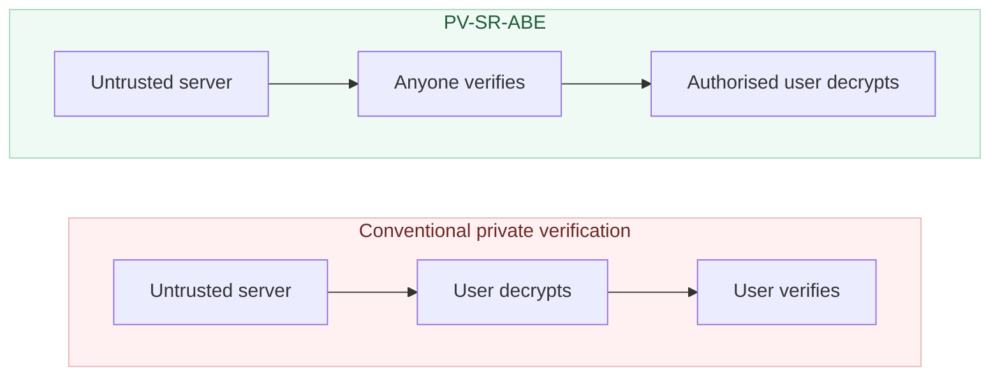
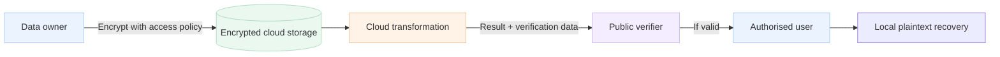
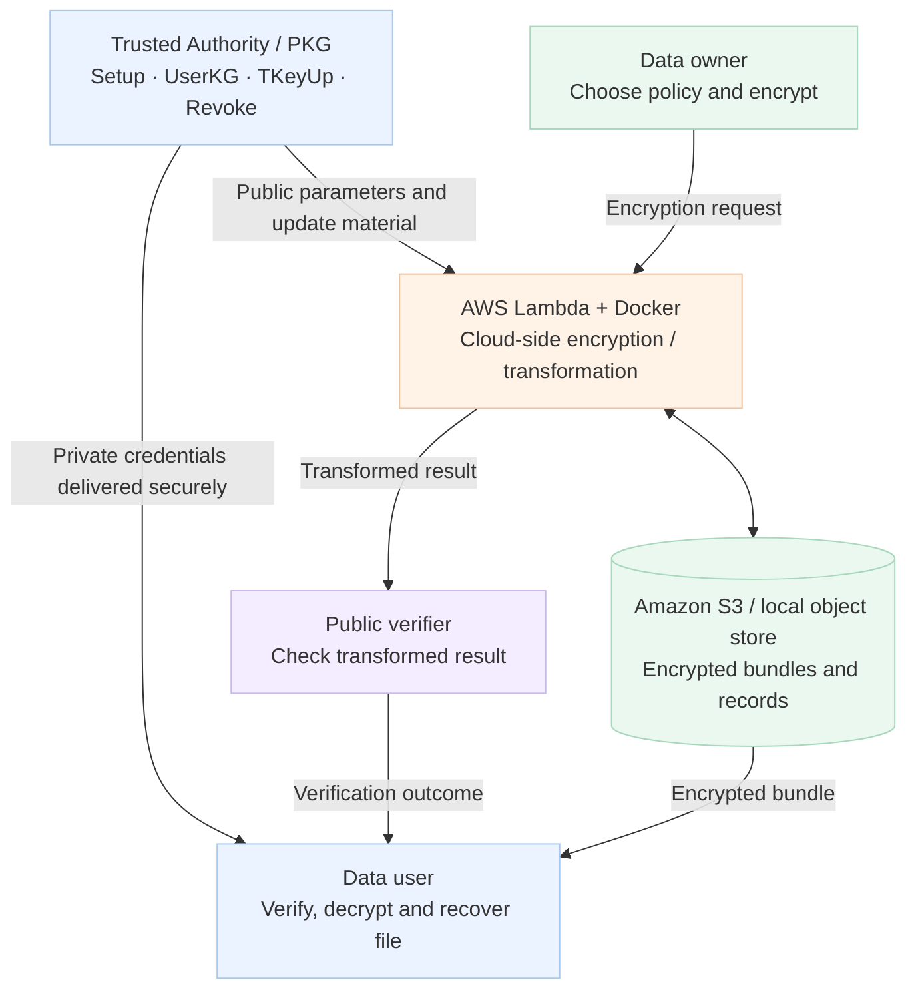
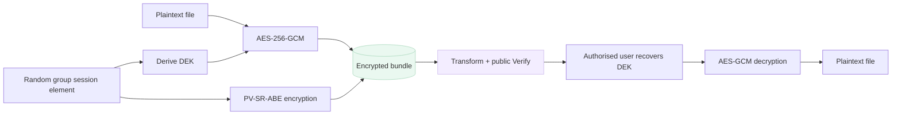
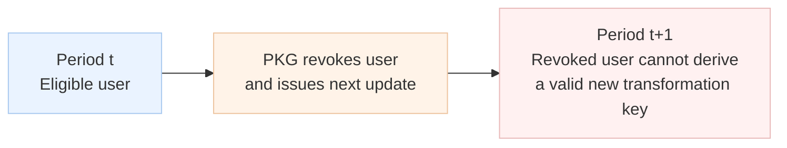

# Publicly Verifiable Cloud Framework

### Public Verifiable Server-Aided Revocable Attribute-Based Encryption (PV-SR-ABE)

**Python · AWS Lambda · Docker · Charm-Crypto · PBC · AES-256-GCM · Amazon S3**

> **Research proof of concept, not a production security service.** This repository explores how the PV-SR-ABE scheme from the accompanying research paper can be adapted to a cloud-based hybrid-encryption workflow. The paper's security proofs do not automatically establish the security of every engineering extension.

## Why does this matter?

Imagine a company storing confidential documents in the cloud. Only employees with appropriate attributes (for example, `Engineering` **and** `Project-Alpha`) should decrypt them. If an employee leaves, their access should be revoked. To reduce client computation, the company asks a cloud server to perform expensive pairing-based transformations—but **how can anyone tell whether that server returned a correct result?**

Traditional verifiable outsourcing may require an authorised user to decrypt before checking the result. **PV-SR-ABE makes verification public and moves it before decryption.**

## Before and after: who can verify?



*Conceptual comparison: public verification checks the outsourced transformation; it does not grant the verifier access to the plaintext.*

## Example: sharing a confidential project file

*Illustrative application, not a deployed enterprise case study.*

1. The **Trusted Authority (PKG)** generates public parameters and issues user keys linked to identities and attributes.
2. The **data owner** encrypts a file under an access policy and a time period.
3. The **cloud server** performs the eligible user's outsourced transformation using time-update material.
4. An **independent public verifier** checks the transformed result with public verification information—without the user's secret key.
5. Only an **authorised, non-revoked user** completes decryption locally.



## What this repository actually implements

The project contains a **pairing-based research prototype**, local command-line tools, an AWS Lambda container workflow, storage adapters, public verification utilities, and tests. The Lambda workflow uses S3-style requests and responses; local object storage supports development and demonstrations.

### System architecture



*Trust boundary: the master secret stays with the trusted authority; public verification does not require private decryption keys. The diagram is a simplified conceptual view of the repository's workflows.*

### Hybrid encryption: ABE protects the key, AES protects the file

The paper describes encryption over pairing-group elements. This prototype adapts the design for ordinary file bytes: a random group element is used to derive an AES-256-GCM data-encryption key (DEK), and PV-SR-ABE protects the group element.



**Important:** the combined hybrid construction is an engineering adaptation; its security must be evaluated separately from the paper's IND-sCPA proof.

## Three core security features

| Feature | What it means |
|---|---|
| **Public verifiability** | A third party can check an outsourced transformation using public verification information, without the user's decryption key. |
| **Verify-then-decrypt** | Incorrect outsourced results can be rejected before local plaintext recovery. |
| **User revocation** | A binary-tree-based update mechanism prevents revoked users from obtaining valid transformation keys for applicable later periods. |

### How revocation works



*Revocation is time-based: it does not retroactively erase plaintext or keys previously obtained by a user.*

## Research scheme vs. prototype

The paper defines nine algorithms: `Setup`, `UserKG`, `TKeyUp`, `TranKG`, `Encrypt`, `Transform`, `Verify`, `Decrypt`, and `Revoke`. The prototype implements corresponding operations in `crypto/pv_core.py` and related utilities. The paper studies **selective IND-CPA security in a one-user revocation setting** and **selective public verifiability**; these are theoretical claims about the specified construction, not a certification of the deployed software.

## Technology stack

| Component | Technology |
|---|---|
| Core cryptography | Python, Charm-Crypto, PBC, GMP |
| File encryption | AES-256-GCM via `cryptography` |
| Cloud processing | AWS Lambda, Docker container image |
| Object storage | Amazon S3 / local object store |
| Tests | pytest |

## Project structure

```text
.
├── architecture/             # Original detailed architecture diagram
├── crypto/                   # PV-SR-ABE core, CLI and cloud integration
│   ├── pv_core.py
│   ├── ta_local.py
│   ├── lambda_encrypt.py
│   ├── client_decrypt.py
│   ├── lambda_service.py
│   ├── public_verify.py
│   └── ...
├── docker/                   # AWS Lambda container Dockerfile
├── docs/                     # Algorithm, security and deployment notes
├── example/                  # Demonstration scripts
├── paper/                    # Research material (if redistribution permitted)
├── tests/                    # End-to-end and failure-case tests
├── requirements.txt
├── requirements-dev.txt
└── README.md
```

## Try the local proof of concept

**Prerequisites:** a working Python environment with Charm-Crypto, PBC and GMP (or a compatible Docker image). Installing `requirements.txt` alone may not install native pairing dependencies, particularly on Windows.

From the repository root:

```bash
cd crypto

# Initialise trusted authority (contains secret material)
python ta_local.py setup --curve SS512 --depth 4 --out keys/pv_setup.json

# Issue credentials to an eligible user
python ta_local.py userkg --setup keys/pv_setup.json \
  --id alice@example.com --attrs "A,C" --out keys/alice_user.json

# Encrypt a sample message; save the printed object ID
python lambda_encrypt.py --setup keys/pv_setup.json \
  --policy "(A and C)" --t 1 \
  --plaintext "confidential record" --store_dir keys/store

# Issue a time-period update
python ta_local.py tkeyup --setup keys/pv_setup.json \
  --t 1 --out keys/tuk_t1.json

# Replace OBJECT_ID with the identifier printed by the encryption command
python client_decrypt.py --setup keys/pv_setup.json \
  --user keys/alice_user.json --tuk keys/tuk_t1.json \
  --object_id OBJECT_ID --store_dir keys/store
```

The expected successful path is **Transform → Verify → Decrypt**. See [deployment instructions](docs/deployment.md) for the cloud setup and [public-verification documentation](docs/PUBLIC_VERIFICATION.md) for the auditing workflow.

## Tests and validation

The repository includes test cases for the normal encryption/decryption path, an unsatisfied access policy, and a mismatched time period.

```bash
pip install -r requirements-dev.txt
pytest tests/ -v
```

These commands assume the pairing dependencies are already available. **Test outcomes have not been independently re-run for this README**, and passing prototype tests does not replace a security audit.

## Security notes and limitations

- **Never commit** generated master secrets, user private keys, `keys/`, `.env`, or AWS credentials. Review Git's staged files before pushing.
- The trusted authority remains responsible for master secrets, identity enrolment, and revocation.
- The prototype's pairing configuration is intended for research and should not be assumed to meet modern production or post-quantum security requirements.
- Cloud identity/access management, authenticated communication, key lifecycle controls, logging integrity and operational hardening require additional work before production use.
- A public verification result establishes correctness only within the scheme's assumptions and the implementation's actual behaviour.

## Research background

Based on **“Public Verifiable Server-Aided Revocable Attribute-Based Encryption”** by **Luqi Huang, Fuchun Guo, Willy Susilo and Yumei Li** (research manuscript supplied with this project).

The paper introduces public verification of outsourced results, a verify-then-decrypt mechanism, user-specific transformations, and revocation through time-period key updates. This repository explores how those ideas can be represented in a practical, cloud-oriented prototype.

---

*Research in verifiable cryptography, translated into an inspectable cloud-security prototype.*
